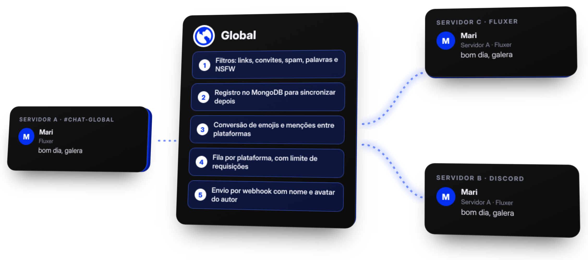

<div align="center">

<a href="https://globalbot.site"></a>

<br>

[](https://globalbot.site)
[](https://web.fluxer.app/oauth2/authorize?client_id=1562253521942745089&scope=bot&permissions=4503600164629568)
[](https://nodejs.org)
[](https://www.mongodb.com)
[](LICENSE)

</div>

> [!NOTE]
> Este repositório é o **bot**. O código do site fica em [globaloficial/global_site](https://github.com/globaloficial/global_site).

<br>

<h2 align="center">Sobre</h2>

<p align="center">
O Global liga comunidades do <a href="https://fluxer.app">Fluxer</a> e do Discord em um único chat.<br>
Cada servidor escolhe um canal, e as mensagens dele aparecem nos canais de todos os outros,<br>
com edições, exclusões e replies sincronizados.
</p>

<br>

<h2 align="center">Como funciona</h2>

<div align="center">

</div>

<br>

<div align="center">

| Etapa | O que acontece |
| :---: | --- |
| **1** | Alguém escreve no canal global do servidor |
| **2** | A mensagem passa pelos filtros: links, convites, spam, palavras e NSFW |
| **3** | O vínculo é guardado no MongoDB, para sincronizar edições e exclusões |
| **4** | Emojis e menções são convertidos para a plataforma de destino |
| **5** | Cada plataforma tem a sua fila, com limite de requisições |
| **6** | O bot envia por webhook, com o nome e o avatar de quem escreveu |

</div>

<p align="center">O Global precisa da permissão <b>Gerenciar Webhooks</b> no canal conectado. Sem ela, a mensagem não chega e o bot avisa no canal.</p>

<br>

<h2 align="center">Fluxer e Discord</h2>

<p align="center">
Os dois bots rodam no mesmo processo e falam com o núcleo por adaptadores.<br>
Cada plataforma tem a sua própria fila de envio, então o limite de uma não trava a outra.
</p>

<br>

<h2 align="center">Pontes privadas</h2>

<p align="center">
Quem não quer usar o chat global pode ligar canais de servidores amigos, entre Fluxer e Discord.<br>
As mensagens ficam só dentro da ponte.
</p>

<div align="center">

| Comando | O que faz |
| --- | --- |
| `g.ponte criar [nome]` | Cria a ponte com o canal atual e gera um código |
| `g.ponte entrar <código>` | Liga o canal atual a uma ponte |
| `g.ponte listar` | Mostra as pontes do servidor |
| `g.ponte sair` | Tira o canal atual da ponte |
| `g.ponte remover <código> <id>` | O dono tira outro servidor da ponte |
| `g.ponte encerrar <código>` | O dono apaga a ponte |

</div>

<p align="center">Até 10 servidores por ponte. Um canal não pode estar no chat global e em uma ponte ao mesmo tempo.</p>

<br>

<h2 align="center">Comandos</h2>

<p align="center">No Discord os comandos também existem como slash. É preciso ter a permissão <b>Gerenciar Canais</b>.</p>

<div align="center">

| Comando | O que faz |
| --- | --- |
| `g.conectar` · `g.desconectar` | Define ou remove o canal do chat global |
| `g.pausar` · `g.retomar` | Pausa e retoma a conexão |
| `g.config` | Mostra o estado da conexão, do webhook e dos filtros |
| `g.automod` | Ajusta os filtros automáticos |
| `g.ponte` | Cria e gerencia pontes privadas |
| `g.perfil` · `g.destacar` | Perfil do usuário e destaque de mensagens |
| `g.report` | Envia uma mensagem para a moderação |
| `g.botinfo` · `g.ping` · `g.ajuda` | Informações, latência e lista de comandos |

</div>

<br>

<h2 align="center">Instalação</h2>

<p align="center">Requer Node.js 20+ ou Bun, um MongoDB em execução e o token de um bot do Fluxer.</p>

```sh
git clone https://github.com/globaloficial/global
cd global
bun install
cp .env.example .env
```

<div align="center">

| Variável | Obrigatória | Padrão |
| --- | :---: | --- |
| `TOKEN` | Sim | nenhum |
| `MONGODB_URI` | Não | `mongodb://127.0.0.1:27017/global` |
| `DISCORD_TOKEN` | Não | vazio, e a ponte com o Discord fica desligada |
| `NSFW_URL` | Não | `http://localhost:3000` |
| `NSFW_API_KEY` | Não | vazio |
| `ENTREGA_CONCORRENCIA` | Não | `10` |
| `ENTREGA_REQS_POR_SEGUNDO` | Não | `35` |
| `DISCORD_CONCORRENCIA` | Não | `10` |
| `DISCORD_REQS_POR_SEGUNDO` | Não | `30` |

</div>

> [!IMPORTANT]
> Sem o serviço NSFW no ar, mídia é bloqueada por padrão. Ajuste `NSFW_URL` ou mantenha o serviço rodando.

Para o Discord, ative a **Message Content Intent** no [Developer Portal](https://discord.com/developers/applications). O bot também precisa de **Gerenciar Webhooks** e **Gerenciar Mensagens** nos canais conectados.

<br>

<h2 align="center">Execução</h2>

```sh
bun index.js
```

Com Node.js, passe o arquivo de ambiente explicitamente:

```sh
node --env-file=.env index.js
```

<br>

<h2 align="center">Desenvolvimento</h2>

```sh
bun run lint
bun run typecheck
bun run test
```

<br>

<h2 align="center">Estrutura</h2>

```
global/
├── index.js
├── migrations/
├── listas/
├── src/
│   ├── commands/        conexao, geral, staff e dono
│   ├── events/          eventos do Fluxer
│   ├── plataformas/     adaptadores do Fluxer e do Discord
│   ├── services/        filtros, retransmissão, sincronização, pontes e entrega
│   ├── models/          Guild, MensagemGlobal, Ponte e outros
│   ├── handlers/        carregamento e execução de comandos
│   └── util/
└── test/
```

<br>

<h2 align="center">Cores</h2>

<div align="center">

| Uso | Cor |
| --- | --- |
| Oficial |  |
| Fundo |  |
| Cartões |  |

</div>

<br>

<h2 align="center">Privacidade e licença</h2>

<p align="center">
A política de privacidade está em <a href="PRIVACIDADE.md">PRIVACIDADE.md</a>.<br>
Distribuído sob a <a href="LICENSE">PolyForm Noncommercial 1.0.0</a>.
</p>

<br>

<p align="center">Criado por xMqR · Apoiado financeiramente por Joao.</p>
